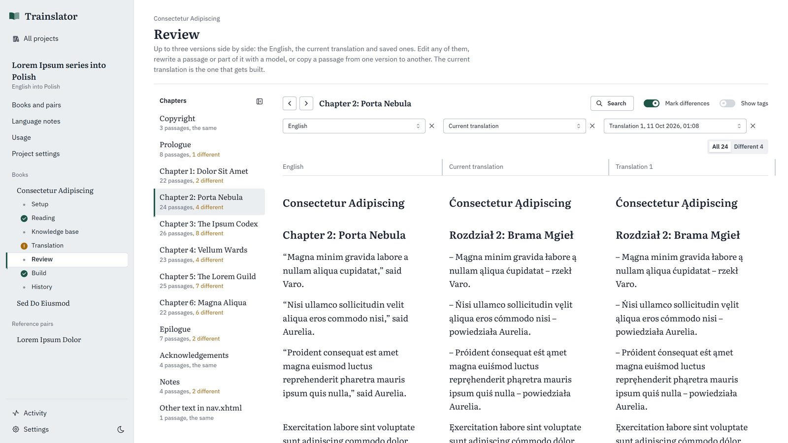

# Trainslator

Trainslator translates EPUB books with AI. It learns from books that already have a human
translation, reads your book to settle its names and terms, then translates it and writes an EPUB
in the target language with the original formatting.

It runs on your own computer: a local server with a browser UI. It talks to Anthropic's API, to
Ollama (on your computer or on Ollama Cloud) through Ollama's own API, to Claude Code with your
Claude subscription, and to any OpenAI-compatible API (OpenAI, OpenRouter, DeepSeek, Gemini, vLLM
and others). Your books, knowledge bases and logs stay in a folder on your disk.

**New here? Read the [tutorial](TUTORIAL.md):** it walks through every screen, from installation
to a finished book, with screenshots, recommendations and troubleshooting.



## How it works

1. **Reference pairs (phase 1).** You add a book and its published translation. The
   app proposes which chapters match; you check and confirm. The AI then reads each chapter
   pair and builds a knowledge base of the translator's decisions: names, invented terms,
   wordplay, forms of address and style. Ordinary words are left out. Pairs are optional.
2. **Reading the new book (phase 2).** The AI reads the new book chapter by chapter,
   before anything is translated. It writes a synopsis of each chapter and builds the book's own
   knowledge base, consistent with the reference pairs. Things it can't decide yet (say, a
   character's gender) become open questions that later chapters, or you, answer.
3. **Translation (phase 3).** The book is translated in chunks or whole chapters, with both
   knowledge bases in every request. Inline formatting (italics, links, footnote markers)
   travels as placeholders and is put back exactly; everything outside the translated text stays
   byte for byte as it was.
4. **Review, build and history.** You compare versions side by side, fix, rewrite or replace
   text, and build the EPUB. Every translation run and every build is saved, so you can compare
   and restore.

Each phase starts only when you press its button, so you can review and edit the knowledge
bases in between. Your edits are kept when a phase runs again.

Books can be translated from **English, German or Polish** into any language, including
right-to-left ones. You pick both when you create a project. The instructions to the AI are in
English with the source language named in them, and the AI's notes (synopses, knowledge base
notes, questions) stay in English too. German and Polish change the form of names ("des Ordens",
"w Krakowie"), so for them the AI is asked for names and terms in their base form, and the app
finds them in any form when it counts where an entry appears or which reference entries a book
needs.

## Features

- **Providers:** OpenAI, OpenRouter, DeepSeek, Gemini, Anthropic, vLLM / SGLang / llama.cpp,
  Ollama (local or cloud), Claude Code (your subscription, counted as $0) and any other
  OpenAI-compatible API. **Test** checks a model and suggests settings that work.
- **A model per step,** with its own reasoning effort, and an optional **advisor**: a strong
  model the other models may consult with a short, self-contained question.
- **Language notes** for the target language, drafted by AI and edited by you, in every request.
- **Knowledge bases** you can read and edit: entries grouped by language, facts such as gender
  and forms of address, style rules, open questions you can answer or ask a model about, and
  the exact text the model receives. Your changes are locked and survive re-runs.
- **Alignment** of reference books by chapter, proposed by length or with AI.
- **Translation in chunks or whole chapters,** with checks on every answer, automatic repair
  turns, and passages that need attention marked for you, including passages that may still be
  partly in the source language.
- **Review** with up to three versions side by side, a chapter list with differences, resizable
  columns, editing, rewriting a passage or a selection with any model, copying between versions,
  and search and replace across the book.
- **History** of translations, builds and knowledge bases, with compare and restore.
- **Jobs** that run in the background, report progress live, and can be paused, resumed and
  retried; estimates before each run and a usage page with tokens and costs.

## Requirements

- **Node.js 24.21 or newer.** With nvm: `nvm install` and `nvm use` read the version from
  `.nvmrc`.
- **pnpm 12.** With Corepack: `corepack enable`. pnpm then picks the version pinned in
  `package.json`.
- **Access to an AI model:** an API key for Anthropic, Ollama Cloud or an OpenAI-compatible
  provider, a local server such as Ollama or vLLM, or Claude Code logged in with a Claude
  subscription.
- **DRM-free, reflowable EPUB files.**

## Getting started

```sh
pnpm install
cp .env.example .env      # then add your API key(s), see below
pnpm dev
```

Open http://localhost:5173. Then:

1. **Settings → Connections and models:** add a connection (choose the provider kind, which
   fills in sensible defaults), add one or more models, and press **Test**. The test sends a
   few small requests and suggests settings that work with that provider.
2. **Settings → Models for each step:** choose a model for each step. A fast model is fine for
   phase 1, a medium one for phase 2, and the strongest you can afford for phase 3.
3. **Projects:** create a project with its source and target languages. Draft the language notes
   with AI and adjust them; they go into every request.
4. Add reference pairs, then the book. The sidebar lists each book's stages (setup, reading,
   knowledge base, translation, review, build, history) and marks the ones that are done.

The [tutorial](TUTORIAL.md) covers each of these steps in detail.

`pnpm dev` runs the API server (port 5174) and the UI dev server (port 5173) together, and
restarts the server when the code changes, which interrupts running jobs. For everyday use and
long runs, build the UI once and run a single server:

```sh
pnpm build
pnpm start                # http://127.0.0.1:5174
```

## API keys

Keys are read by the server and never sent to the browser. Two ways to give a key:

- **Environment variable (recommended):** put it in `.env`, for example
  `OPENROUTER_API_KEY=sk-…`, and in the connection choose "Environment variable" with that
  name. `.env` is not committed. Restart the server after changing `.env`.
- **Paste key:** it is stored in `data/settings.json` on your disk, and shown masked in the UI.

Claude Code needs no key: it runs the `claude` program on your computer with the subscription
you're logged in with, and never uses an API key.

## Data folder

Everything is stored as JSON files in `./data` (not committed), or in the folder set by
`TRAINSLATOR_DATA_DIR`:

```
data/
  settings.json                  connections, models, step settings, advisor
  jobs/                          running and finished jobs
  corpus/                        your EPUBs for pnpm test:corpus (optional)
  projects/<id>/
    project.json, language-notes.md
    logs/calls.jsonl             one line per AI request: tokens, cache hits, cost
    cache/llm/                   answers that passed the checks, reused when a request repeats
    pairs/<id>/                  the two EPUBs, alignment, phase 1 work, kb.json
    books/<id>/                  the EPUB, setup, kb.json, phase 2 and 3 work
      history/                   saved translations, builds, earlier knowledge bases
      output/                    the latest build and its report
```

Back up the folder to keep your work. Deleting a project deletes its folder.

## Environment variables

| Variable | Meaning |
|---|---|
| `PORT` | Port of the API server (default 5174). |
| `TRAINSLATOR_DATA_DIR` | Where the data folder is (default `./data`). |
| `TRAINSLATOR_LOG_BODIES` | `1` saves the full request and response of every AI call in `logs/calls/`. Useful when a step misbehaves; the files contain book text and get large. |
| Your key variables | Any names you use in connections, for example `OPENAI_API_KEY`. |

## Commands

| Command | What it does |
|---|---|
| `pnpm dev` | API server and web UI for development, restarting the server on code changes. |
| `pnpm build` | Builds the web UI into `dist/web`. |
| `pnpm start` | One server on 127.0.0.1:5174 with the API and the built UI. |
| `pnpm check` | Type check, lint and tests. |
| `pnpm test:live --base-url … --model … --kind … --key-env … [--source en\|de\|pl] [--target pl]` | Runs every step against a real API on a tiny invented book (about 15 small requests) and reports whether prompt caching works. |
| `pnpm test:corpus` | Round-trips every EPUB in `data/corpus` through the reader and writer without AI, and reports anything that wouldn't survive translation unchanged. Good for checking unusual books. |
| `pnpm translate:dev book.epub [--source de] --target pl --base-url … --model …` | Phase 3 and build from the command line, without knowledge bases. For debugging. |

## Security

The server listens on 127.0.0.1 only. It rejects requests from other websites (by checking the
`Host` and `Origin` headers), accepts only JSON or file uploads, and never shows stored keys.
Don't expose the port to a network: there are no user accounts.

## Costs

Each phase shows an estimate of tokens (and cost, when you enter the model's prices) before it
runs, and each project's **Usage** page shows what was actually used per step, with a separate
row for the advisor. Requests are arranged so that the long, unchanging parts (instructions and
knowledge bases) come first, which lets providers with prompt caching charge less for them.
Claude Code requests count as $0, because your subscription pays for them.

For a sense of scale: a 37,000-word book with one reference pair (a 19,000-word book and its
translation) took about 55 requests over all three phases with a fast model: about 1 million
input tokens, most of them cached, and 170,000 output tokens, in about 6 minutes.

## Limitations

- Source books must be in English, German or Polish (see below for adding a language).
- Fixed-layout EPUBs and DRM-protected books are rejected.
- Text inside images, SVG and MathML is left as is.
- For right-to-left targets, the text direction is set, but the book's CSS is not mirrored.
- One user, one computer.

## Adding a source language

Each source language is a JSON file in `src/languages/` (`en.json`, `de.json`, `pl.json`), checked
against `language.schema.json`, so an editor completes and validates the fields. To add one:

1. Copy `de.json` to a file named after the language tag, for example `cs.json`, and fill it in:
   - `tag`: the language tag, `cs`;
   - `article`: "a" or "an", as in "a Czech novel";
   - `keyArticles`: articles to ignore when matching names (none for Czech);
   - `endings` and `alternations`: case endings and stem changes, so names are found in any form;
   - `frontMatter`, `backMatter` and `chapterWords`: title words that help guess the book's parts;
   - `numberWords` and `ordinals`: for matching "Chapter One" with "Kapitola první";
   - `commonWords`: frequent short words, used to notice text left untranslated;
   - `preambles`: phrases a model may put before a translation into this language.
2. Import the file in `src/languages/index.ts`, add it to the list of files there, and add its tag
   to `SOURCE_LANGUAGES`.
3. Add the tag to the language lists the tests expect in `src/languages/index.test.ts`, then run
   `pnpm check`. A file that doesn't match the schema stops the server at startup and fails the
   tests.

A language without a file can still be a target; a file only adds checks for it there.
