# Trainslator tutorial

A guide for new users, from installation to a finished book. It goes through every screen in the
order you'll use them, explains what happens behind each button, and ends with recommendations
and troubleshooting. For a short overview, installation details and the list of commands, see the
[README](README.md).

The screenshots come from a demo project: placeholder Lorem Ipsum books, "translated" by a
stand-in test model, so the Polish in them is placeholder text too.

**How to read this guide.** Names of buttons, tabs and switches are written in bold, exactly as
the app shows them: **Translate the book**. A path such as **Settings → Models for each step**
means: click the first, then the second.

## Contents

1. [How Trainslator works](#1-how-trainslator-works)
2. [Quick start](#2-quick-start)
3. [Installing and running](#3-installing-and-running)
4. [Connecting AI models](#4-connecting-ai-models)
5. [Choosing models for each step](#5-choosing-models-for-each-step)
6. [Projects and language notes](#6-projects-and-language-notes)
7. [Reference pairs: alignment and learning (phase 1)](#7-reference-pairs-alignment-and-learning-phase-1)
8. [Working with knowledge bases](#8-working-with-knowledge-bases)
9. [Adding a book and setting it up](#9-adding-a-book-and-setting-it-up)
10. [Reading the book (phase 2)](#10-reading-the-book-phase-2)
11. [Translating (phase 3)](#11-translating-phase-3)
12. [Review](#12-review)
13. [Building the EPUB](#13-building-the-epub)
14. [History](#14-history)
15. [Usage and costs](#15-usage-and-costs)
16. [Jobs and progress](#16-jobs-and-progress)
17. [Recommendations](#17-recommendations)
18. [Troubleshooting](#18-troubleshooting)

---

## 1. How Trainslator works

A good human translator doesn't start on page one. They read the book first, look at how earlier
translators handled the same author or series, and keep notes: what each character is called,
which invented words became what, who says *ty* and who says *pan* to whom. Trainslator does the
same, in three phases, and keeps those notes in **knowledge bases** you can read and edit.

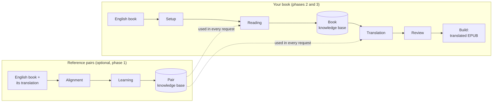

Reference pairs are optional: a book can be translated with only its own knowledge base. Each
phase starts only when you press its button, so you can check and correct the knowledge bases in
between. **History** keeps every translation run, every build and each earlier knowledge base, so
you can compare and restore.

### The three phases

1. **Phase 1: Learning from reference pairs.** You give the app an English book together with its
   published human translation. You confirm which chapters correspond, and the AI reads each
   chapter pair, noting the translator's decisions: how names were rendered, what invented words
   became, how wordplay was solved, which forms of address were used, and general style. The
   findings are merged into the pair's knowledge base. Ordinary dictionary words are left out on
   purpose.
2. **Phase 2: Reading your book.** Before anything is translated, the AI reads your English book
   chapter by chapter, in order. For each chapter it writes a short synopsis and updates the
   book's knowledge base, staying consistent with the reference pairs. Anything it can't decide
   yet (is *Sam* a man or a woman?) becomes an **open question** that a later chapter, or you, can
   answer. A final review cleans up the knowledge base at the end.
3. **Phase 3: Translating.** The AI translates the book in chunks or whole chapters, with the
   instructions, your language notes and both knowledge bases in every request. Formatting
   travels as placeholders and every answer is checked. You then review the result, side by side
   with the English and with earlier versions, and build the EPUB.

### Words used in this guide and in the app

| Term | Meaning |
|---|---|
| Project | Translates books from one source language (English, German or Polish) into one target language. Holds its reference pairs, books, language notes and usage. |
| Reference pair | A book in the source language and its published translation into the project's language, used only for learning (phase 1). |
| Book | The EPUB in the source language you want translated. |
| Knowledge base | A list of entries (names, places, terms, phrases, wordplay) with their translations, facts such as gender, notes and examples, plus numbered style rules. Each pair and each book has one. |
| Open question | A knowledge base entry the AI couldn't decide, with the question it needs answered. |
| Locked entry | An entry you saved. Locked entries are kept exactly as you set them when phases run again; the AI can only leave suggestions for them. |
| Language notes | A short Markdown text about the target language (gender, forms of address, punctuation, how names are written) that goes into every request. |
| Passage | One paragraph, heading, caption, list item or similar piece of text: the unit that gets translated, reviewed and edited. |
| Placeholder | A marker such as `<g1>…</g1>` or `<x1/>` that stands for formatting (italics, a link, a footnote marker, a line break) while the model translates. |
| Step | One kind of AI work, such as "Phase 1: read chapters" or "Phase 3: translate". Each step has its own model and reasoning settings. |
| Connection | An AI service the app talks to (OpenAI, Anthropic, Ollama, Claude Code and others), with its address, key and limits. Models belong to a connection. |
| Advisor | An optional strong model that the other models may consult with a self-contained question when they're unsure. |
| Job | A long-running piece of work (a phase, a re-translation, a build) that runs on the server, reports progress, and can be paused, resumed or cancelled. |
| Current translation | The translation the app is working on and builds from. Earlier ones are saved in History. |

---

## 2. Quick start

The short path from nothing to a translated EPUB. Every step links to its full description.

1. **Install the tools:** Node.js 24.21 or newer and pnpm 12. See [section 3](#3-installing-and-running).
2. **Install and start the app:** `pnpm install`, copy `.env.example` to `.env` and add your API
   key, then `pnpm dev` and open http://localhost:5173.
3. **Connect an AI provider:** **Settings → Add connection**, then **Add model** and **Test**.
   Apply the suggested settings if the test offers any. See [section 4](#4-connecting-ai-models).
4. **Choose a model for each step:** **Settings → Models for each step**. Fast models for phase 1,
   mid-range for phase 2, your strongest for phase 3. Press **Save**. See
   [section 5](#5-choosing-models-for-each-step).
5. **Create a project:** **New project**, give it a name and the language to translate into. See
   [section 6](#6-projects-and-language-notes).
6. **Write the language notes:** **Language notes** in the sidebar, **Draft with AI**, then read
   and correct them.
7. **Add a reference pair (optional, recommended):** **Add reference pair**, check and
   **Confirm alignment**, then **Learn from this pair**. Look through its knowledge base. See
   [section 7](#7-reference-pairs-alignment-and-learning-phase-1).
8. **Add your book and set it up:** **Add book**; on **Setup** choose the reference pairs, the
   chapters phase 2 should read and any files to keep in English. See
   [section 9](#9-adding-a-book-and-setting-it-up).
9. **Let the AI read the book:** **Reading → Read the book**. Then open **Knowledge base**, answer
   the open questions and correct anything important. See [section 10](#10-reading-the-book-phase-2).
10. **Translate:** **Translation**: choose **Chunks** or **Whole chapters**, press **Translate the
    book**, then fix the passages that need attention. See [section 11](#11-translating-phase-3).
11. **Review, build and download:** compare and polish in **Review**, then **Build → Build the
    EPUB → Download**. See [sections 12 to 14](#12-review).

---

## 3. Installing and running

### What you need

- **Node.js 24.21 or newer.** With nvm, `nvm install` and `nvm use` in the project folder read the
  version from `.nvmrc`. Node runs the server's TypeScript directly, so there's no build step for
  the server.
- **pnpm 12.** The easiest way is Corepack, which ships with Node: `corepack enable`. pnpm then
  uses the exact version pinned in `package.json`.
- **Access to at least one AI model**, any of:
  - an API key for Anthropic, OpenAI, OpenRouter, DeepSeek, Google Gemini or Ollama Cloud;
  - a model server on your own machine or network (Ollama, vLLM, SGLang, llama.cpp);
  - Claude Code installed and logged in with a Claude subscription (no API key involved).
- **DRM-free, reflowable EPUB files.** Books with DRM and fixed-layout EPUBs (picture books, comics
  laid out page by page) are rejected when you add them.

### Install and start

```sh
corepack enable           # once, if pnpm isn't installed
pnpm install
cp .env.example .env      # then put your API key(s) in .env
pnpm dev
```

`pnpm dev` starts two servers: the API server on port **5174** and the web interface on port
**5173**. Open http://localhost:5173 in your browser.

For everyday use, especially long translation runs, build the interface once and run a single
server:

```sh
pnpm build
pnpm start                # then open http://127.0.0.1:5174
```

> **Why `pnpm start` for long runs.** `pnpm dev` restarts the server whenever the app's source code
> changes. That's convenient while developing, but a restart interrupts running jobs. They can be
> resumed (see [section 16](#16-jobs-and-progress)), but it's simpler not to have them
> interrupted. If you never edit the code, both commands behave the same.

### API keys

Keys are only read by the server and are never sent to the browser. You can give a key in two
ways:

- **Environment variable (recommended).** Put it in `.env` and, in the connection, choose
  **Environment variable** with that name. `.env` isn't committed to git. Restart the server after
  changing `.env`.
- **Paste key.** The key is stored in `data/settings.json` on your disk and shown masked in the
  interface.

```sh
# .env
PORT=5174                   # port of the API server (the dev UI on 5173 forwards /api here)
TRAINSLATOR_DATA_DIR=       # where projects, books and logs are stored (default ./data)
TRAINSLATOR_LOG_BODIES=     # 1 = save the full request and response of every AI call

# Keys, referenced by name in Settings → Connections
ANTHROPIC_API_KEY=
OLLAMA_API_KEY=
OPENAI_API_KEY=
OPENROUTER_API_KEY=
```

### Where your work is stored

Everything lives as JSON files in `./data`, or in the folder named by `TRAINSLATOR_DATA_DIR`.
There's no database. Back up that folder to keep your work; deleting a project in the app deletes
its folder. The full layout is in the [README](README.md#data-folder).

### Security

The server listens on `127.0.0.1` only. It rejects requests from other websites (it checks the
`Host` and `Origin` headers), accepts only JSON and file uploads, and never shows stored keys.
There are no user accounts, so don't expose the port to a network.

### Finding your way around

The sidebar on the left is the main navigation. **All projects** is at the top. Inside a project
you'll see **Books and pairs**, **Language notes**, **Usage** and **Project settings**, then the
project's books and reference pairs. When a book or pair is open, its stages appear under it,
each with a mark: a green tick when it's done, a spinning circle while it runs, an orange
exclamation mark when it finished with errors or stopped early, red when it failed, and an empty
circle when it hasn't run yet.

At the bottom of the sidebar are **Activity** (running and recent jobs), **Settings** and a
light/dark switch. On a phone, the sidebar opens from the menu button.

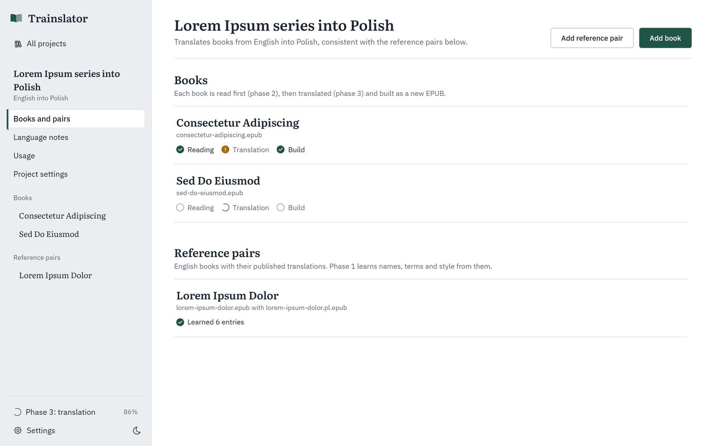

*A project's page. The sidebar lists the project's pages, its books and its reference pairs; each
book shows marks for Reading, Translation and Build.*

---

## 4. Connecting AI models

Open **Settings → Connections and models**. A **connection** is one AI service: its address, key
and limits. Each connection has one or more **models**. Settings apply to every project.

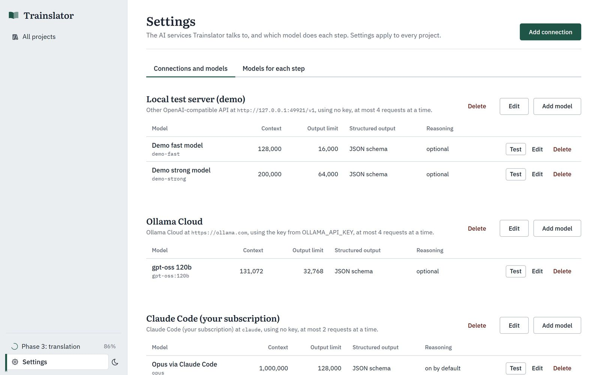

*Connections and models: each connection with its address, key and parallel limit, and its models
with context, output limit, JSON mode and reasoning.*

### Adding a connection

Press **Add connection** and choose its **Kind**. The kind fills in sensible defaults for that
service; you can change any of them later.

| Kind | Default address | Key variable | Good to know |
|---|---|---|---|
| OpenAI | `https://api.openai.com/v1` | `OPENAI_API_KEY` | Prompt caching is automatic. Reasoning models think by default; to turn it down, set the "reasoning off" template to `{"reasoning_effort": "minimal"}` or `"none"`. |
| OpenRouter | `https://openrouter.ai/api/v1` | `OPENROUTER_API_KEY` | Many providers behind one key. For Anthropic and Gemini models, set **Cache markers** to `anthropic` to get prompt caching. Reports the cost of each call. |
| DeepSeek | `https://api.deepseek.com/v1` | `DEEPSEEK_API_KEY` | Supports JSON mode but not JSON schemas; the schema is described in the prompt instead. Thinking is on by default. Automatic caching. |
| Google Gemini (OpenAI-compatible) | `https://generativelanguage.googleapis.com/v1beta/openai` | `GEMINI_API_KEY` | Some Gemini models can't turn thinking off; set **Reasoning** to **Always on** for those. |
| Anthropic | `https://api.anthropic.com` | `ANTHROPIC_API_KEY` | Anthropic's own Messages API: JSON-schema output, prompt caching on the stable parts of each request, adaptive thinking with an effort level (low, medium, high, xhigh, max). |
| vLLM / SGLang / llama.cpp server | `http://localhost:8000/v1` | none | Your own server. Prefix caching is automatic; cached-token counts appear only when vLLM runs with `--enable-prompt-tokens-details`. Some models use the key `thinking` instead of `enable_thinking`. |
| Ollama, **On this computer** | `http://localhost:11434` | none | Ollama's own API. The app asks Ollama for the model's context window (`num_ctx`), so set **Context window** to what your machine's memory can handle. Effort becomes Ollama's thinking level (low, medium, high). |
| Ollama, **Ollama Cloud (API)** | `https://ollama.com` | `OLLAMA_API_KEY` | Key from ollama.com/settings/keys. Use the model names Ollama lists (for example `gpt-oss:120b`), without a `:cloud` suffix. |
| Claude Code (your subscription) | `claude` | none | Runs Claude Code on your computer with the Claude subscription you're logged in with, never an API key. Requests count as $0. See below. |
| Other OpenAI-compatible API | `http://localhost:8080/v1` | none | Anything that speaks the OpenAI Chat Completions format. Use **Test** to find which settings it accepts. |

#### Connection fields

| Field | What it does |
|---|---|
| **Name** | How the connection is shown in the app. |
| **Base URL** | The API's address. Hosted APIs need `https://`; the form warns if you type `http://` for a server on the internet, because the request would be redirected and fail. For Claude Code this field is called **Command**: `claude`, or the full path to it. |
| **API key** | **Environment variable** (the name of a variable in `.env`), **Paste key**, or **No key** for local servers. A pasted key shows as stored; leave it as is to keep it. |
| **Extra headers** | Extra HTTP headers, for example for a proxy. Tick **Secret** to have a value masked like a key. |
| **Max parallel requests** | How many requests run at once across all models of this connection. Set it to your provider's rate limit. Default 4 (2 for Claude Code). |
| **Retries** | How often a failed request (rate limit, server error) is retried before it counts as failed. Default 4. |
| **Time limit per request (s)** | The longest a single request may take. Default 1800 seconds (30 minutes). |
| **Give up after silence (s)** | While a streamed answer arrives, how long the app waits without receiving anything before it gives up. Default 600 seconds. |
| **Stream responses** | Recommended. Keeps long requests alive, shows progress while the answer arrives, and gives usage per call. |

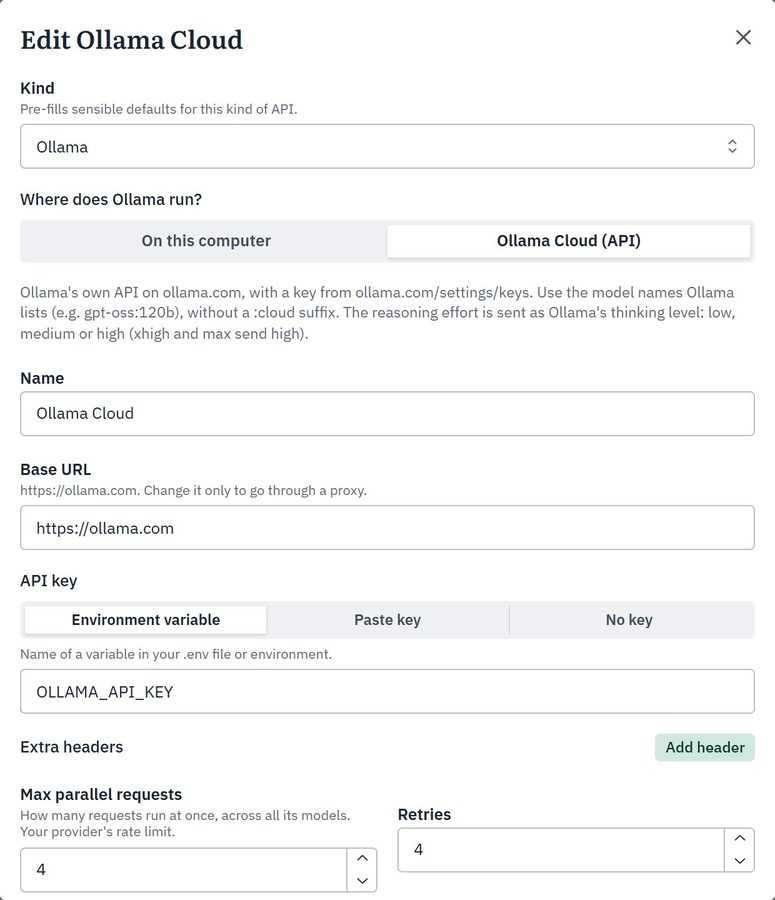

*Editing a connection. For Ollama you choose where it runs; the key comes from an environment
variable.*

### Adding a model

On the connection, press **Add model**. Start typing in **Model name**: when the service can list
its models, you pick from the list and the context window, output limit and prices are filled in
where the service reports them.

| Field | What it does |
|---|---|
| **Model name** | Exactly as the API expects it, for example `claude-opus-5-5`, `qwen3:14b` for local Ollama, `gpt-oss:120b` for Ollama Cloud. For Claude Code: `opus`, `sonnet`, `haiku`, `fable` or a full model name. |
| **Label** | The name shown in the app. |
| **Context window (tokens)** | How much the model can read in one request. The app checks before each request that the prompt plus the answer fit. For local Ollama this is also the memory Ollama sets aside. |
| **Max output (tokens)** | The longest answer the model can write, thinking included. Whole-chapter translation needs a generous value. |
| **JSON output** | How the app gets structured answers: **JSON schema (strict)** (best), **JSON mode**, or **Described in the prompt only** for services that support neither. Every answer is checked either way. |
| **Length parameter** | OpenAI-style APIs only: `max_tokens` or `max_completion_tokens`, whichever the service accepts. |
| **Reasoning** | **Optional (off unless enabled)**, **On by default** (the "off" template must be sent to turn it off), or **Always on**. |
| **Send temperature** | Many reasoning models reject a temperature; turn this off for them. |
| **Reasoning on / Reasoning off** | JSON added to the request to switch thinking on or off. `{{effort}}` and `{{budget}}` are replaced with the step's settings. The connection kind fills in working templates. |
| **Prompt caching, Cache markers, Cache lifetime, Send prompt cache key** | Caching controls. Anthropic: caching on or off and a 5-minute or 1-hour lifetime. OpenAI-style: `anthropic` cache markers (for Anthropic and Gemini models through OpenRouter) and the prompt cache key. |
| **Prices** | Optional, in US dollars per million tokens: Input, Cached input, Cache write, Output. With prices, estimates and the Usage page show costs. |

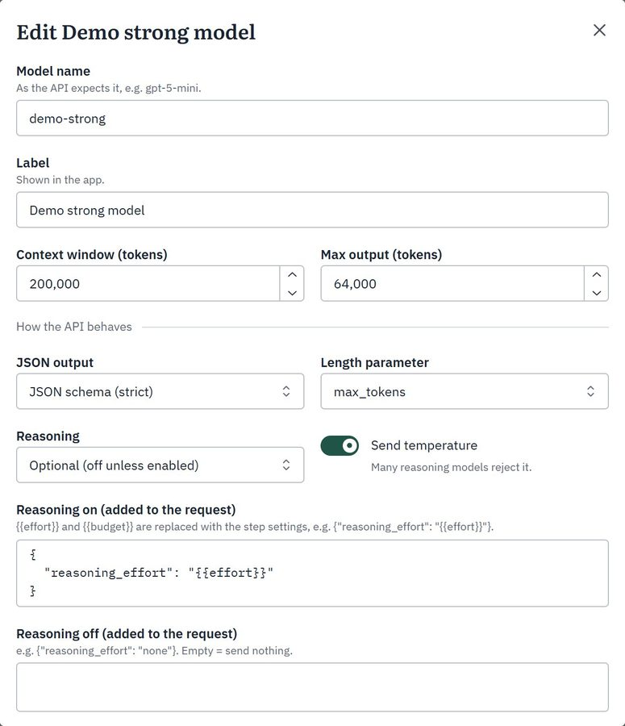

*A model's settings. The kind of connection fills in working values; Test checks them.*

### Testing a model

Press **Test** next to a model, then **Run test**. The test sends 3 to 5 small requests and checks
that the model:

- answers at all, with the address, key and name you gave;
- returns valid JSON in the format the app needs;
- accepts its parameters (length parameter, temperature, reasoning settings);
- can switch reasoning on and off;
- can call tools, which it needs to consult the advisor.

Tick **Also check long prompts and caching** to also send a prompt of up to 24,000 tokens twice.
That shows whether long prompts arrive whole and whether the provider reports cached tokens. When
the test finds better settings, it lists them under **Suggested settings**; press
**Apply suggestions**.

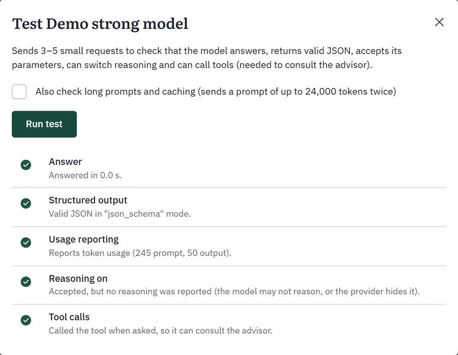

*A passed test. Suggested settings would appear below the checks, with Apply suggestions.*

> **Test every new model once, with the long check.** It catches the problems that are otherwise
> hard to spot later: a service that silently ignores the JSON schema, a local server that cuts
> long prompts, a reasoning switch that doesn't work.

### Claude Code as a provider

The **Claude Code (your subscription)** kind runs the `claude` program on your computer for each
request, using the Claude subscription you're logged in with. It never uses an API key: the app
removes any Anthropic key variables from the program's environment.

- Install Claude Code and log in once in a terminal. In the connection, **Command** is `claude`,
  or the full path if it isn't on your PATH.
- It runs without tools, without your Claude Code settings, plugins or memory, and without saving
  sessions. The stable part of each prompt goes into a system prompt file.
- Requests are counted as **$0** on the Usage page and in estimates (your subscription pays).
- Each request starts the program anew, so keep **Max parallel requests** low (the default is 2).
  Your subscription's usage limits apply; when they're used up, the job stops and tells you when
  the limit resets. Press **Resume** after that time.
- Claude Code models can be the advisor, but they can't ask the advisor themselves.

Roughly what the app runs for each request:

```sh
claude -p --output-format stream-json --verbose --include-partial-messages \
  --system-prompt-file <stable instructions> --tools "" --safe-mode \
  --no-session-persistence --disable-slash-commands \
  --model sonnet --effort medium --json-schema '{…}'
# the rest of the prompt goes in on stdin
```

Extra command-line arguments can be added per step through **Extra request parameters**, for
example `{"args": ["--fallback-model", "sonnet"]}`.

---

## 5. Choosing models for each step

Open **Settings → Models for each step**. Each kind of AI work has its own model and settings, so
you can spend money where it matters: on the translation itself.

| Step | What it does | Suggested model |
|---|---|---|
| Utility | Small jobs: language notes, the table of contents and the book title. | mid-range |
| Phase 1: read chapters | Reads each chapter pair of a reference book and lists the translator's choices. | fast, inexpensive |
| Phase 1: merge findings | Turns the findings from all chapters into the pair's knowledge base. | mid-range |
| Phase 2: read chapters | Reads the new book chapter by chapter and updates its knowledge base. | mid-range |
| Phase 2: final review | Cleans up the book's knowledge base after all chapters are read. | mid-range |
| Phase 3: translate | Translates the book using the knowledge bases. | the strongest you can afford |

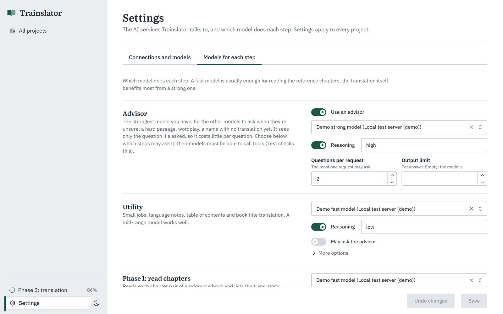

*Models for each step. The advisor is set up at the top; each step below has its model, reasoning
and the switch to ask the advisor.*

For each step:

- **Model**: any model from your connections.
- **Reasoning** with an **effort**: none, minimal, low, medium, high, xhigh or max. Not every
  provider knows every level; the model's templates translate the effort into what the provider
  expects.
- **May ask the advisor**: lets this step's model consult the advisor (below).
- **More options**: **Temperature** (empty means the provider's default), **Output limit** (empty
  means the model's maximum), **Reasoning budget** (for providers that take a token budget), and
  **Extra request parameters**, a JSON object merged into every request of this step.

Press **Save** at the bottom; **Undo changes** goes back to what's saved. Each phase's run panel
repeats which model and effort it will use, and warns about slow settings.

> **High effort is slow.** At high, xhigh or max a single request can think for several minutes.
> The run panels warn about it. For phases 1 and 2, low or medium is usually enough; reserve
> higher effort for phase 3, and only if you can wait.

### The advisor

The advisor is the strongest model you have, kept for the moments when another model is unsure: a
hard or ambiguous passage, a pun, a name with no translation yet, a conflict between a knowledge
base and the text. The step's model gets a tool called `ask_advisor`. When it uses it, the advisor
receives **only the question**, nothing else from the conversation, so the model is told to quote
the passage and the entries involved. The advisor answers with a recommendation and a short
reason, and the model carries on.

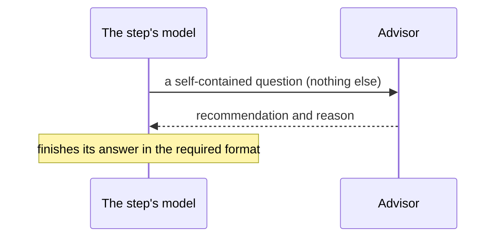

Because the advisor sees only a short question, each consultation is cheap, even with an
expensive model. To set it up, at the top of **Models for each step**:

1. Turn on **Use an advisor** and choose the advisor's model. A model must be chosen before you
   can save.
2. Set its reasoning (usually on, at a high effort), **Questions per request** (the most one
   request may ask, 1 to 10) and an optional **Output limit** per answer.
3. Turn on **May ask the advisor** for the steps that should be allowed to ask. Their models must
   be able to call tools; the model **Test** checks this.

Failed advice never fails a request: if the advisor can't answer, the model continues on its own.
The advisor's usage has its own row on the Usage page.

---

## 6. Projects and language notes

### Creating a project

On **All projects**, press **New project**. Give it a **Name** (for example "Fantasy series into
Polish"), choose **Translate from** (English, German or Polish) and **Translate into**. You can
search target languages by name or type any language code such as `pl`, `pt-BR` or `zh-Hant`. The
app works out the target language's script and writing direction itself. Both languages are fixed
once the project exists; **Project settings** shows them.

This guide's examples translate an English book into Polish. In a project with a German or Polish
source, the app says German or Polish wherever this guide says English: in column headings, in
**Review**, in the build report. The instructions to the AI and its own notes (synopses, entry
notes, questions) are in English whatever the source.

With a German or Polish source, names and terms change form in the text: *des Ordens* for *Orden*,
*Krakowa* for *Kraków*. The AI is asked to list them in their base form (nominative, without an
article), and the app finds an entry in any of its forms when it counts the chapters an entry
appears in and when it picks the reference entries a book needs (**Only entries in this book**).
When a book or pair is imported, the app also warns if an EPUB says it's in a different language
than the one it's used as.

The project page lists its **Books**, each with marks for Reading, Translation and Build, and its
**Reference pairs**, each with the number of entries learned. **Add reference pair** and
**Add book** are at the top.

### Language notes

Language notes describe what a translator into your language has to keep track of: grammatical
gender, formal and informal address, how names are written and inflected, dialogue and quotation
punctuation, number and date formats, and which facts the knowledge base should record. They go
into **every request** of every phase, so they shape everything.

- Choose the model in the drop-down next to **Draft with AI** (the Utility step's model is the
  default) and press it. The draft appears when it's done; the page updates by itself.
- **Edit** (or **Write notes**) opens a Markdown editor: `#` headings, `-` lists, `**bold**`. Press
  **Save notes**.
- **Draft again with AI** replaces the current notes after asking you.

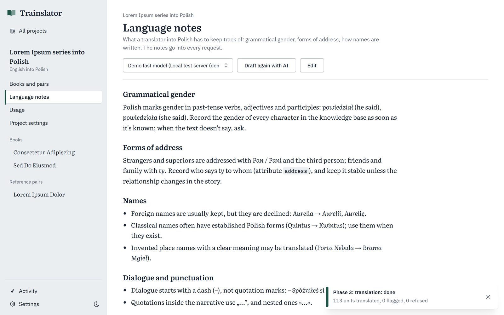

*Drafted language notes. The model picker, Draft again with AI and Edit are at the top.*

> **Spend ten minutes here.** Read the draft as an editor would. Fix anything wrong and add your
> house rules, for example "Dialogue uses dashes, not quotation marks", "Characters address
> strangers with Pan/Pani" or "Keep English honorifics like Mr. untranslated in names". A rule
> written here applies to the whole book; a rule you forget has to be fixed passage by passage
> later.

### Project settings

- **Name**: **Rename** the project.
- **Review**: **Pause for review after each phase**. In the current version every phase starts
  only when you press its button, so you always get the chance to review in between.
- **Saved AI answers**: answers that passed the checks are kept and reused when exactly the same
  request repeats, which makes resumed and repeated runs free. **Clear saved answers** makes every
  step ask the models again.
- **Delete project**: deletes the project folder with all its books, knowledge bases and
  translations. This can't be undone.

---

## 7. Reference pairs: alignment and learning (phase 1)

A reference pair teaches the AI how a human translator into your language handled a similar book:
ideally an earlier book of the same series, the same author, or the same genre. Pairs are
optional, but with them names, invented terms and tone follow established choices instead of the
model's guesses.

### Adding a pair

On the project page, press **Add reference pair** and choose the **English original** and the
**Published translation**, both as DRM-free EPUBs. The app reads both books' structure and opens
**Alignment**.

### Alignment: which chapters match

Books and their translations don't always have the same chapters: a translation may lack the
acknowledgements, add a translator's note, merge two short chapters, or split a long one. The
alignment table pairs them up. The app proposes an alignment by itself, based on chapter lengths,
titles and numbers; you check it, fix it and confirm it.

- **English chapters** and **Translated chapters** choose how deep in each table of contents the
  chapters are taken from: **Top level**, or **Down to level 2** and so on. Use a deeper level
  when the top level holds parts or volumes rather than chapters.
- **Propose again** offers **By chapter length** (instant, no AI, works when both books have the
  same contents) or **With AI** (matches titles and opening lines, better when the books differ;
  one short request).
- The **Use** checkbox decides which rows phase 1 learns from. Untick front matter, notes,
  licences and anything that exists on one side only.
- The **Length** column compares each row with the book's overall length ratio. Around 100% is
  expected; yellow means somewhat off; red means the two sides probably don't match. Below it,
  "% sure" is the app's confidence. Click the percentage to open **Compare the two sides**,
  showing the start and end of both texts.
- The small arrows next to a chapter move it to the previous or next row. The **⋯** menu offers
  **Compare text**, **Merge with next row**, **Split off the last chapter** and **Unlink the two
  sides**.
- When it looks right, press **Confirm alignment**. You can **Save** without confirming, or
  **Undo** unsaved changes. Phase 1 needs a confirmed alignment.

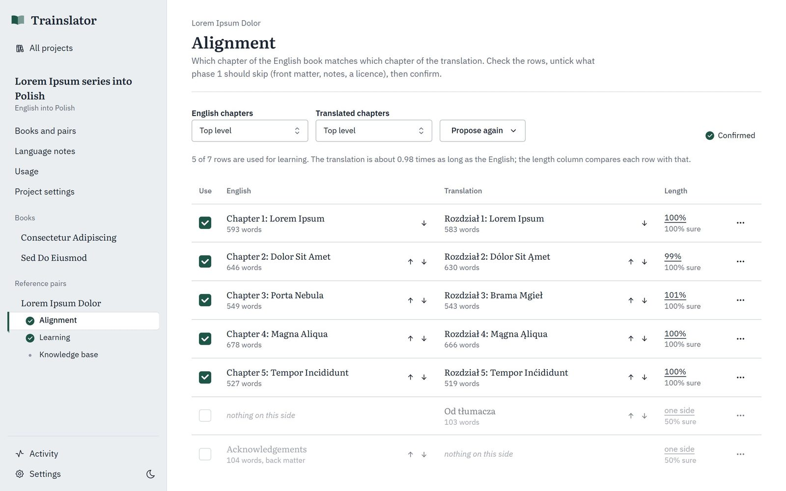

*A confirmed alignment. The translator's note and the acknowledgements exist on one side only, so
they're unticked.*

At the bottom, **Notes about the files** lists anything unusual the app noticed in the EPUBs, and
**Delete pair** removes the pair and what was learned from it. Books that used the pair keep their
own knowledge bases.

### Learning (phase 1)

Open **Learning**. The panel shows an estimate (chapter pairs to read, tokens and, with prices,
cost) and the models it will use. Press **Learn from this pair**.

1. **Read.** Every included chapter pair is read in parallel, up to the connection's parallel
   limit. Long chapters are split into parts. For each, the model lists findings: the English
   name or term, its translation (dictionary form and the forms seen in the text), how it was
   treated (kept, translated, transliterated, adapted, omitted), facts such as gender, a note, and
   short quotes from both sides. It also lists style notes.
2. **Group.** The app groups findings that are about the same thing across chapters, in code,
   without AI.
3. **Merge.** The merge step decides for each group: make it an entry, merge it into another
   entry, or drop it as noise. The result is the pair's knowledge base, plus up to about 30 style
   rules, most important first.

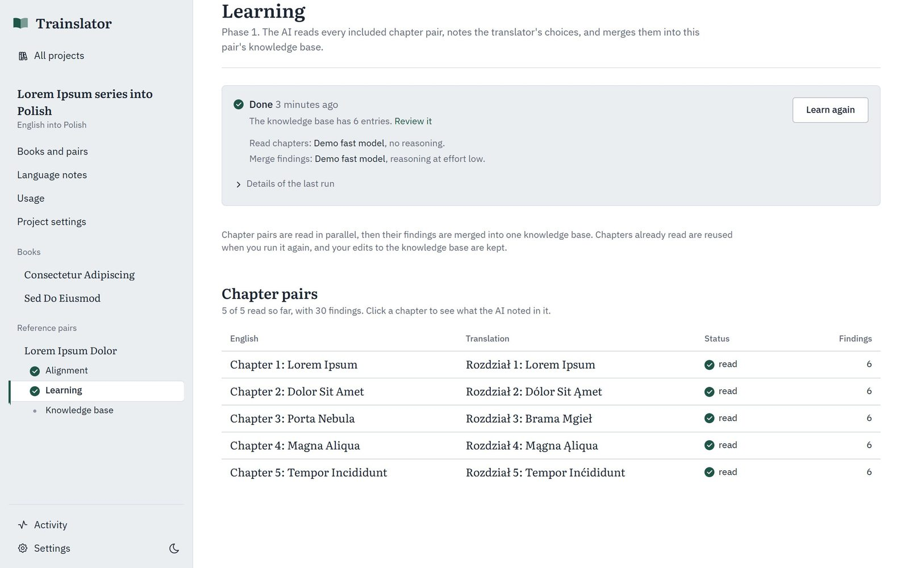

*Learning after a run: the result, the models used, and every chapter pair with its findings.*

The **Chapter pairs** table shows each pair's status (not read yet, reading now, read) and number
of findings. Click a read chapter to see exactly what the model noted, with quotes.

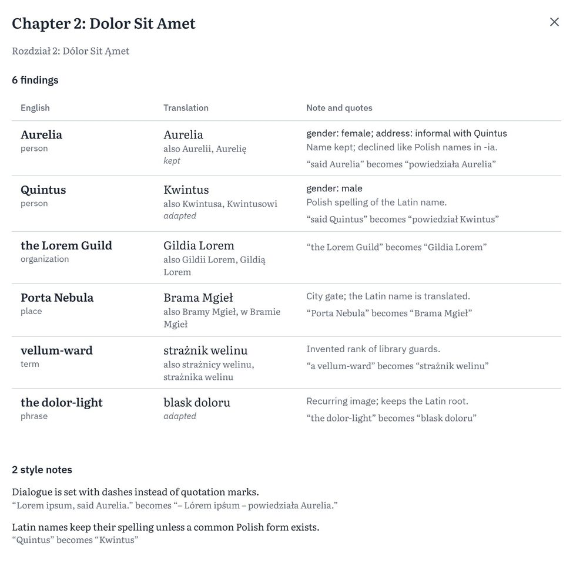

*Clicking a chapter pair shows what the model noted in it, with quotes from both books.*

Chapters already read are reused when you press **Learn again**, and your edits to the knowledge
base are always kept. If some chapters fail, the phase ends as "Done, with errors"; **Retry
failed** in the job row reads only those again.

---

## 8. Working with knowledge bases

Pairs and books share the same editor, under **Knowledge base**. The top line counts entries,
style rules and how many you edited; **Add entry** creates one by hand. There are three tabs:
**Entries**, **Style rules** and **As the AI sees it**.

### Entries

On a book, **open questions** come first, with the AI's question in yellow. Below them, the full
list can be searched (names, translations and notes), filtered by kind, and by status: **All**,
**Open**, **Yours** (locked by you) or **Automatic**. The columns are the original, the
translation, facts and notes, and the kind. A lock icon marks your entries, a question mark the
open ones.

- **Kinds:** person, place, organization, named thing (a ship, a sword, a newspaper), term,
  phrase, wordplay, other.
- **Treatments:** kept (left as in English), translated, transliterated, adapted, omitted, other.

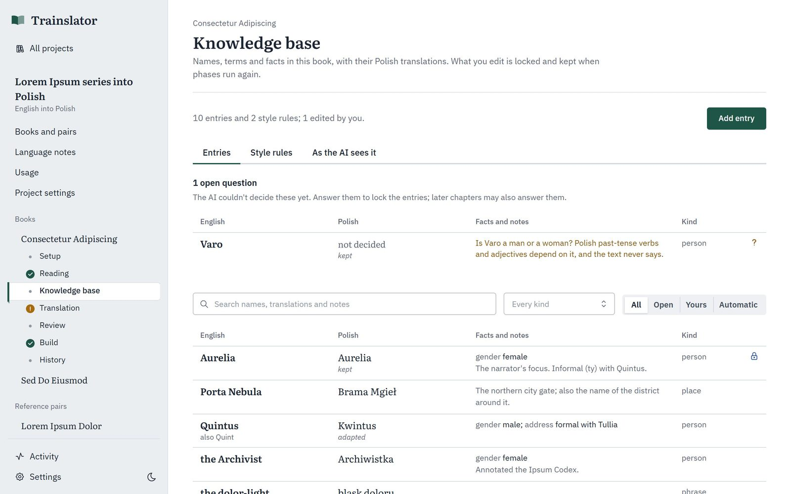

*A book's knowledge base. The open question comes first; the lock marks an entry you saved.*

### Editing an entry

Click a row to open it. The fields are grouped by language, so it's clear what is English and what
is your target language:

| Field | Meaning |
|---|---|
| **Kind, Treatment** | What it is, and how the translation handles it. |
| **Name or term** | As it appears in the source text; for German and Polish in its base form (nominative, without an article). |
| **Also written as** | Other spellings or short forms in the source language, such as a nickname. |
| **Translation** | Its dictionary form in the target language: the form a dictionary would list. |
| **Other forms in (target language)** | Inflected forms and variants that appear in the translated text, for example *Ady, Adzie, Adę* for *Ada*. |
| **Facts (attributes)** | Key and value pairs such as `gender: female`, `address: formal with Hale`, `age: about 60`. These decide verb forms and forms of address in many languages. |
| **Note** | Anything else a translator should know. |
| **Examples** | Up to three short quotes, filled in by the AI. |

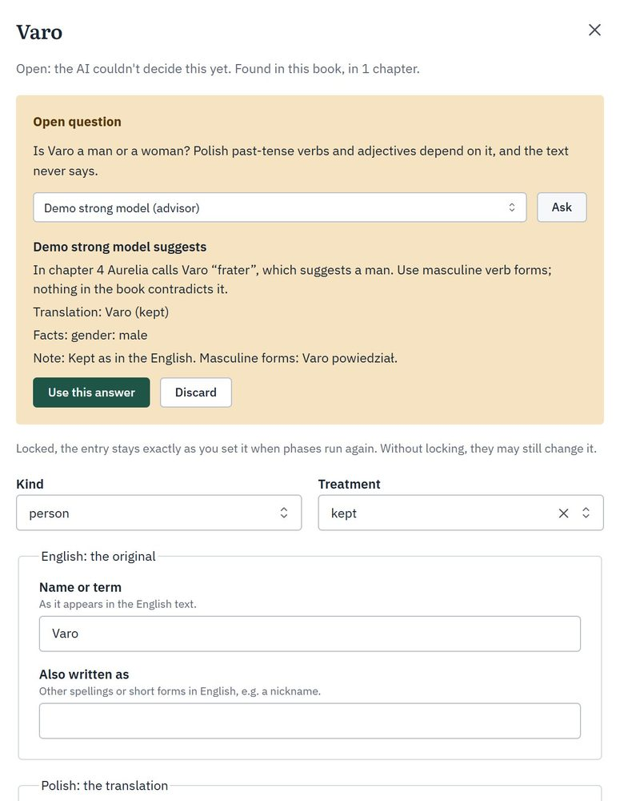

*An open question after pressing **Ask**. **Use this answer** copies the proposal into the fields
below, where you can change it before saving.*

#### Saving, locking and deleting

- **Save and lock** (or **Answer and lock** for an open question) saves your version and locks it.
  A **locked** entry stays exactly as you set it when any phase runs again. The AI can't change
  it; at most it leaves a suggestion, shown in blue in the reading results.
- **Save without locking** saves your change but lets later runs still adjust the entry.
- **Unlock** hands a locked entry back to the AI.
- **Delete** removes the entry, and automatic runs won't add it back.

Your changes are stored separately from what the AI produced and are re-applied after every
automatic rebuild, so re-running a phase never undoes your work.

#### Asking a model about an open question

An open question has a model picker and an **Ask** button. The advisor's model is preselected. The
model answers with an explanation and a proposed translation, treatment, facts and note.
**Use this answer** copies it into the fields so you can adjust it before saving; **Discard** drops
it.

### Style rules

General conventions the translation follows: punctuation, register, how foreign words or units are
handled. The most important come first. **Edit** a rule, delete it with the cross, or type a new
one under **Add a rule**, for example "Keep imperial units; don't convert to metric."

### As the AI sees it

This tab shows exactly the text that goes into requests, with its size in tokens. It's the best
way to check what the model will actually be told. A book's knowledge base looks like this
(shortened):

```
## Characters
- [p2] [locked] Ada Quill → Ada Quill (kept) [gender: female] — forms: Ady Quill, Adzie Quill (also: Ada)
- [p3] Mr. Hale → pan Hale (adapted) [gender: male; address: formal] — forms: pana Hale'a, panu Hale'owi

## Places
- [p5] the Narrows → Przesmyk — forms: Przesmyku, na Przesmyku

## Organizations, titles and named things
- [p1] the Gazette → „Gazeta” — forms: „Gazetę”, „Gazecie” — newspaper title, in quotation marks

## Style rules
1. Dialogue uses dashes (–), not quotation marks.
   e.g. "“You're late,” said Ada." → "– Spóźniłeś się – powiedziała Ada."

## Open questions
- [p4] Sam → (undecided)
    question: Is Sam a man or a woman? Past-tense verbs depend on it.
```

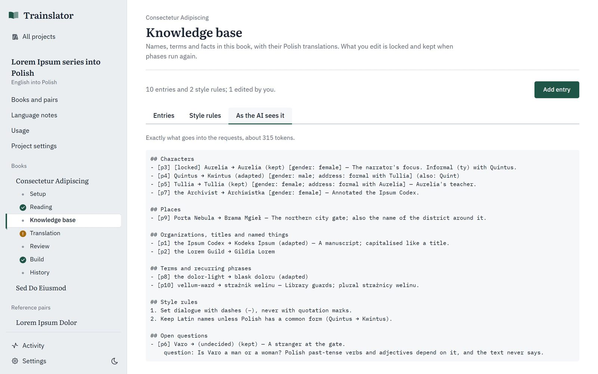

*The demo project's knowledge base in the As the AI sees it tab.*

The short ids (`p1`, `p2`…) let the reading model refer to entries when it edits them. The order is
fixed (by section, then by first appearance), so the same knowledge base always produces the same
text, which lets providers cache it.

---

## 9. Adding a book and setting it up

On the project page, press **Add book** and choose the English EPUB. The app reads its structure
and opens **Setup**, which starts with a summary: word count, number of files, EPUB version and
file name.

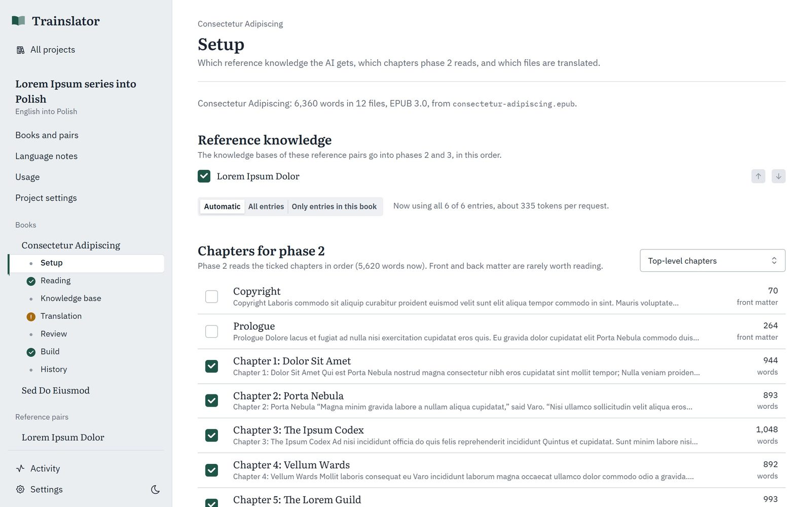

*Setup. Front matter is unticked for phase 2 automatically.*

### Reference knowledge

Tick the reference pairs this book should use and order them with the arrows; their knowledge
bases go into phases 2 and 3 in this order, so put the most relevant pair first. Press **Save the
choice of pairs**. Pairs not learned yet are marked as such.

Below, choose how much of the reference knowledge to send:

- **All entries**: every entry of every chosen pair.
- **Only entries in this book**: only entries whose name or term appears in this book, plus all
  style rules.
- **Automatic** (default): all entries, unless that would take more than about 35% of the smallest
  context window among your phase 2 and 3 models; then only the relevant ones.

The line next to it says what is used now, for example "Now using all 412 of 412 entries, about
9,800 tokens per request."

### Chapters for phase 2

Phase 2 reads the ticked chapters in order. The drop-down chooses how deep in the table of
contents the chapters come from. By default the app ticks the chapters that are in the reading
order, look like body text, and have at least 100 words. Front and back matter (copyright pages,
acknowledgements, an index) are rarely worth reading. The total word count of your choice is shown
above the list.

### Files to translate

Every file is translated unless you switch on **Keep original**, for example for an index or an
English-only appendix. The list shows each file's words, whether it's outside the reading order or
a navigation file, and how many paragraphs have broken markup. Those paragraphs stay
untranslated, because their text can't be put back safely.

Changes to chapters and files show a bar with **Save setup** and **Undo**.

### Output

- **Give the translation a new book identifier** (on by default, recommended): reading apps then
  treat the translation as a different book from the original instead of mixing them up.
- **Remove embedded fonts**: use it when a build reports characters the book's fonts can't show
  (see [section 13](#13-building-the-epub)).

**Notes about the files** lists anything unusual in the EPUB, such as text inside images or SVG
that will stay in English. **Delete book** removes the book with its knowledge base, translations
and builds; reference pairs are kept.

---

## 10. Reading the book (phase 2)

Open **Reading**. Before you start, the panel shows how many chapters will be read, how many tokens
of reference knowledge go into each request, and the estimated tokens and cost. Press **Read the
book**.

### What happens

Chapters are read **one after another**, never in parallel, because each chapter builds on what
the earlier ones established. For every chapter (or part of a long chapter) the model receives the
instructions, the reference knowledge bases, the synopses written so far, the book's knowledge base
as it stands, and the chapter's text. It answers with:

- a **synopsis** of the chapter in English (at most about 120 words), used later for context when
  translating;
- **edits** to the knowledge base: add an entry, update one, resolve an open question, or remove an
  entry (with a reason).

The app checks every edit before applying it:

- Adding an entry that already exists only fills in what it's missing, and an entry you deleted
  can't be added back.
- Updates and removals need an existing entry; a removal also needs a reason, and an open entry
  needs a question.
- Edits to locked entries aren't applied but kept as suggestions for you.
- Edits that break these rules are rejected (shown in red) and sent back to the model once to be
  fixed.

After the last chapter, a **final review** merges duplicates, fixes inconsistencies and resolves
open questions the synopses answer. The knowledge base is saved after every chapter, so an
interrupted run continues from the last finished chapter.

### The Chapters list

Each chapter shows its title, the synopsis and how many changes it made (rejected ones in red).
Open it to read the full synopsis and every change: **Added**, **Updated**, **Resolved** or
**Removed**, with the model's reason. Suggestions for entries you locked appear in blue.

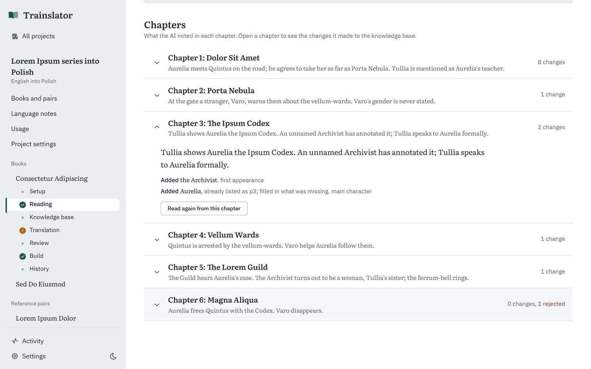

*Reading results. Chapter 3 is open: the model re-added Aurelia, so the existing entry was filled
in instead. Chapter 6 shows a rejected edit.*

### Running it again

- **Continue reading**: appears when a run stopped before the end.
- **Run the final review again**: after a finished run, for example after you answered questions.
- **Read again from this chapter** (inside a chapter): that chapter and all later ones are read
  anew, with fresh answers from the models. Your own changes are kept.
- **Read the whole book again**: every chapter is read again from an **empty** knowledge base, and
  the models are asked anew instead of repeating earlier answers. The current knowledge base is
  saved in History first, so you can restore it if the new one comes out worse. Your own changes
  are kept unless you tick **Also drop my own changes**; the dialog lists what that would drop. The
  translation isn't changed; translate again to use the new knowledge base.

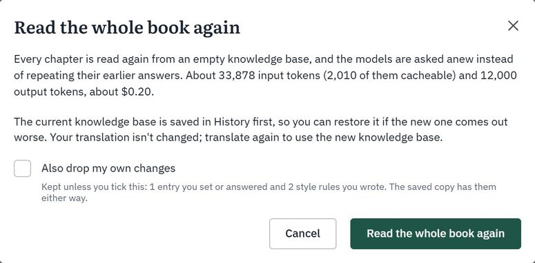

*Read the whole book again: the estimate, what happens to the current knowledge base, and the
option to drop your own changes.*

### After reading: answer the questions

Open **Knowledge base**. Answer the open questions (or **Ask** a model), and correct and lock what
matters most: main characters with their gender and forms of address, recurring invented terms,
titles. Every locked entry is one less thing the translation can get wrong. While a reading run is
still going, answers you give are queued and applied between chapters.

> **Can I skip phase 2?** Yes. The Translation page warns that names and terms will be less
> consistent, but lets you translate anyway. For a short story or a test it's fine; for a novel
> it's worth the cost.

---

## 11. Translating (phase 3)

Open **Translation**. The run panel shows how many chunks or chapters are left, the estimate, the
model, and a choice of how to send the book to the model: **Chunks** or **Whole chapters**, with a
**?** that explains the difference. Press **Translate the book**.

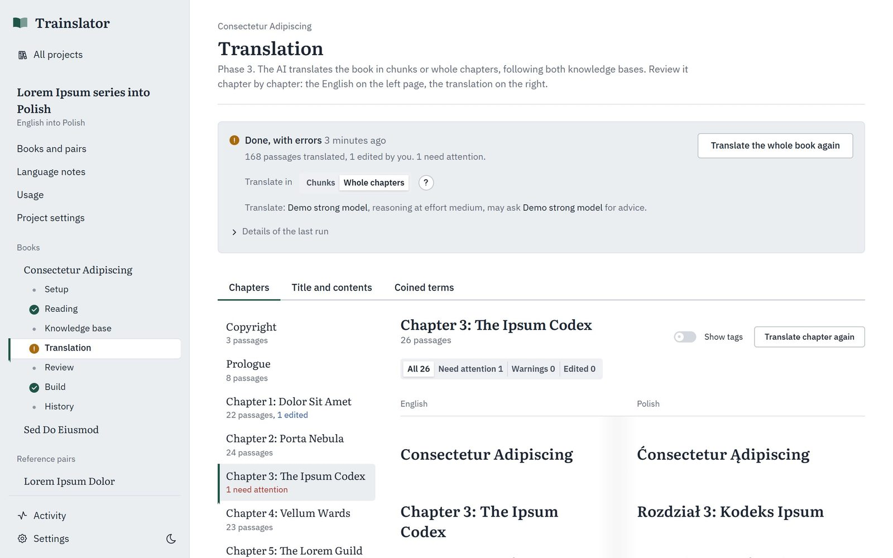

*Translation after two runs. The chapter list marks a chapter with a passage that needs attention
and one with an edit by you.*

### Chunks or whole chapters

Both use the same instructions, knowledge bases and checks. They differ in how much of the book the
model sees while it translates.

- **Chunks:** each chapter is cut into chunks of up to about 1,700 words, translated one after
  another. Each chunk also gets the last 3 paragraphs before it, with their translation.
- **Whole chapters:** each chapter is translated in one request, together with phase 2's synopses
  of the chapters before it. A chapter over about 5,000 words is split into a few parts; each part
  sees the chapter's text around it and the translation so far.

| | Chunks | Whole chapters |
|---|---|---|
| **Better** | Short answers: models stay careful to the end and rarely drop a sentence. Works with models that can only write short answers. A failed answer is quick and cheap to redo. | The model sees the whole chapter, so speakers, pronouns, tone and word choices stay consistent. It knows the story so far, not just this chapter. Fewer requests. |
| **Worse** | The model sees only a few paragraphs before the chunk and nothing after it, so it can miss who is speaking or who "she" is. Word choices and tone can drift from one chunk to the next. | Long answers: some models condense or skip sentences near the end. A missing paragraph is caught; a sentence missing inside a paragraph is not. Needs a model that can write long answers, up to about 15,000 tokens plus its reasoning; an answer cut off at the limit is retried in halves, which costs more. Each request takes minutes, so progress moves in big steps. |

The cost is about the same either way, because most of it is the translated text. You can switch
between runs: translated chapters and your edits are kept, and only chapters that are partly
translated or have passages that need attention are translated again.

> **Rule of thumb.** With a strong model that writes long answers reliably, use whole chapters.
> With smaller or local models, use chunks.

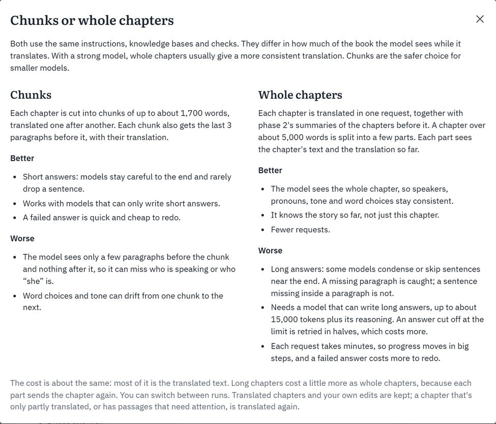

*The **?** next to the mode opens this comparison in the app.*

### What goes into each request

Requests are arranged from the parts that never change to the parts that change every time. The
unchanging start can be cached by providers that support it, which makes it much cheaper after
the first request.

| Part | Changes | Contents |
|---|---|---|
| **Instructions** and your **language notes** | same for the whole book (cached) | The translation rules: one output per passage, keep the placeholders, plain text, follow the knowledge bases, keep the author's tone. |
| **Reference knowledge bases** | same for the whole book (cached) | From the chosen pairs, in your order. |
| **The book's knowledge base** | same until you edit it (cached) | Entries, style rules and any remaining open questions. |
| **The story so far**, and for long chapters **this chapter's text** | whole chapters only | Synopses of earlier chapters; the chapter around the part being translated. |
| **Terms introduced earlier** | grows as you go | Names and terms the model had to coin in earlier chunks, so they're reused. |
| **What happens in this chapter** | per chapter | Phase 2's synopsis. |
| **Translation so far** (whole chapters in parts) or **text just before** (chunks) | per request | For continuity of voice and word choice; not translated again. |
| **The passages to translate** | per request | A JSON list of passages with short ids and placeholders, plus your instruction when you re-translate with one. |

### How formatting survives: placeholders

The model never sees HTML. Inline formatting is replaced with numbered placeholders, and the app
writes the original tags back afterwards. Everything outside the translated text stays exactly as
it was, byte for byte.

1. In the EPUB:

   ```html
   <p>Mr. Hale opened the <i>Gazette</i> and frowned.</p>
   <p>“You’re late,” said Ada.<a epub:type="noteref" href="notes.xhtml#n1">1</a></p>
   ```

2. What the model receives:

   ```
   # Units to translate into Polish
   [
   {"id":"u1","text":"Mr. Hale opened the <g1>Gazette</g1> and frowned."},
   {"id":"u2","text":"“You’re late,” said Ada.<x1/>","keep":["<x1/>"]}
   ]
   ```

3. What the model answers:

   ```json
   {"units":[
     {"id":"u1","text":"Pan Hale otworzył <g1>Gazetę</g1> i zmarszczył brwi."},
     {"id":"u2","text":"– Spóźniłeś się – powiedziała Ada.<x1/>"}
    ],
    "coined":[]}
   ```

4. Written back into the EPUB:

   ```html
   <p>Pan Hale otworzył <i>Gazetę</i> i zmarszczył brwi.</p>
   <p>– Spóźniłeś się – powiedziała Ada.<a epub:type="noteref" href="notes.xhtml#n1">1</a></p>
   ```

- `<gN>…</gN>` wraps formatted text (italics, links, small caps). The model may move it to follow
  natural word order.
- `<xN/>` stands for something kept as it is: a line break, an image, a footnote reference.
- Placeholders listed under `keep` must appear exactly once (links, footnotes, anything with an
  id). Purely decorative ones may be dropped when the language has no equivalent, such as the *th*
  in *19th*.
- Passages without letters (`* * *`, page numbers) are copied without asking the model.
- Invented names and terms the model had to coin are reported in `coined` and collected under
  **Coined terms**.

### Checks on every answer

Each answer is checked. **Errors** are sent back to the model with a list of only the problems (a
repair turn), and if that doesn't help, the failing passages are sent again on their own, up to
twice. A passage that still fails is marked as needing attention, and its best attempt is kept.

| Errors (repaired automatically) | Warnings (shown, nothing blocked) |
|---|---|
| a passage missing, duplicated or not requested | much shorter or much longer than the English |
| an empty translation | identical to the English (untranslated?) |
| a required placeholder missing or repeated; placeholders not properly nested; unknown or malformed placeholders | mostly not in the target language's script |
| HTML tags or Markdown in the text | the same text as a neighbouring passage (shifted?) |
| a preamble such as "Here is the translation:" | may still be partly in the source language (many of its common words are left) |
| quotation marks around a whole passage that aren't in the English | |

### Reading the result

Below the run panel are three tabs: **Chapters**, **Title and contents** and **Coined terms**.

**Chapters** shows a chapter list on the left (with passages, how many need attention, how many are
untranslated or edited) and the open chapter as a book spread: English on the left page,
translation on the right. Filter the passages with **All**, **Need attention**, **Warnings** or
**Edited**. **Show tags** displays the placeholders. Passages that need attention (they failed the
checks, or the model refused them) are marked in red, passages with a warning in orange, and your
own edits in blue.

Hover a passage for its actions in the margin:

- **Edit the translation** (pencil): type your own. The app reminds you which formatting tags to
  keep and checks them on save.
- **Translate again** (circular arrow): with an optional instruction such as "more formal" or "keep
  the pun". This always asks the model afresh.
- **Accept as it is** (tick): for a flagged passage whose remaining problems are only warnings.
- **Go back to the AI translation** (undo arrow): drops your edit.

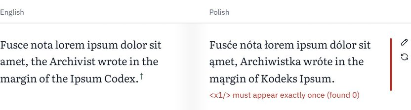

*A passage that needs attention: the model left out the footnote marker. The pencil edits it; the
circular arrow translates it again.*

**Translate chapter again** re-translates every part of the open chapter. Your own edits are kept.

**Title and contents** lists the book's translated title and every label of its table of contents.
Labels that match a chapter heading reuse that heading's translation; the rest are translated in
one small request at the end of the phase. Edit them and press **Save title and contents**.

**Coined terms** lists names and terms the model had to invent because no knowledge base had them,
with conflicts highlighted. Add the important ones to the book's knowledge base to settle them.

### Running it again

- **Translate the rest**: translates what's left, for example after an interruption or after you
  switched mode.
- **Translate the whole book again**: with the current models and settings. The current
  translation, with your edits, is saved to History first, so you can compare or restore it. Saved
  answers are not reused for this.

---

## 12. Review

**Review** is where you polish the translation before building it. It uses the whole width of the
window and shows up to **three versions side by side**: the English, the current translation, and
any translation saved in History. The current translation is the one that gets built.


*Review with three columns. With **Mark differences** on, the chapter list counts the passages that
differ between the translations.*

### Columns

- Each column has a drop-down: **English**, **Current translation**, or **Translation N** with the
  date it was saved. **Add column** adds one (up to three); the cross removes one.
- Drag a column's right edge to change its width; with the edge focused, the arrow keys work too.
  Double-click an edge to reset all widths. Widths are remembered in your browser for each number
  of columns.
- The columns you chose are part of the page address, so a bookmark or the browser's back button
  brings the same view back. **Compare in Review** in History opens exactly such a view.

### Chapters and differences

- The chapter list on the left shows each chapter's passages and, when two or more translations are
  open, how many passages differ. Hide it for more room. The arrows at the top go to the previous
  and next chapter.
- **Mark differences** (with two or more translations open) highlights passages where the versions
  differ and shows the counts. **All** and **Different** filter the passages.
- **Show tags** displays the placeholders.

### Working on a passage

Each translated cell has three actions:

- **Copy to another version**: copy this passage to another open translation. Use it to take the
  better rendering from a saved run into the current one.
- **Back to the AI translation**: drops your edit in that version.
- **Edit or rewrite**: opens a dialog with the English above and the editable text below.

In the **Edit or rewrite** dialog you can type changes yourself, or have a model rewrite it:

- Select part of the text to rewrite only that part (**Rewrite the selection**); otherwise
  **Rewrite the passage** rewrites all of it.
- Choose the **Model** (phase 3's is the default) and an optional **Instruction**, such as "more
  natural", "shorter" or "keep the pun".
- **Send the passages around it** and **Send the knowledge bases** decide how much context the model
  gets. Both are on by default.
- The model's **Proposal** appears with any warnings; **Use it** puts it in the editor, **Discard**
  drops it.
- **Save to …** saves the text to that version.

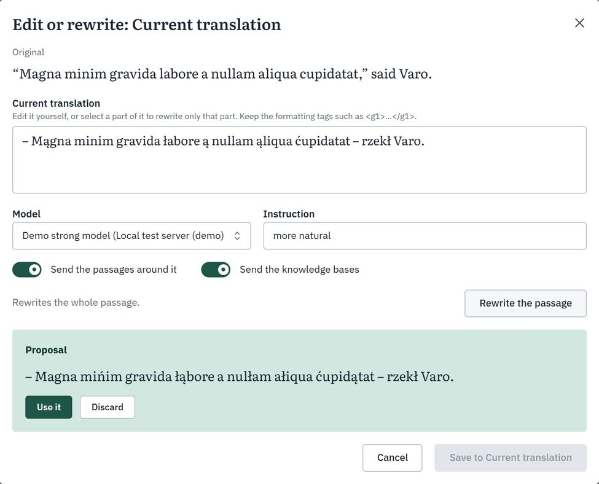

*Edit or rewrite, after asking for a more natural version. **Use it** puts the proposal in the
editor; nothing is saved until you press **Save**.*

Saved translations can be edited too; edits to them change that saved copy.

### Search and replace

Press **Ctrl+F** (or the **Search** button) to open the search panel on the right.

- Type at least 2 letters. By default case and accents don't matter, so *zrodlo* finds *Źródło*
  and *lodz* finds *Łódź*. Tick **Match case and accents** for an exact search, and **Whole words**
  to skip matches inside longer words.
- **This chapter** or **Whole book** sets where to look.
- One checkbox per open column chooses which versions are searched; all are ticked by default.
- Results are listed with the chapter (in whole-book searches), the version, how often it occurs,
  and a snippet. Click one to jump to it; **Enter** and **Shift+Enter** step through them, **Esc**
  closes the panel. Up to 300 results are listed.

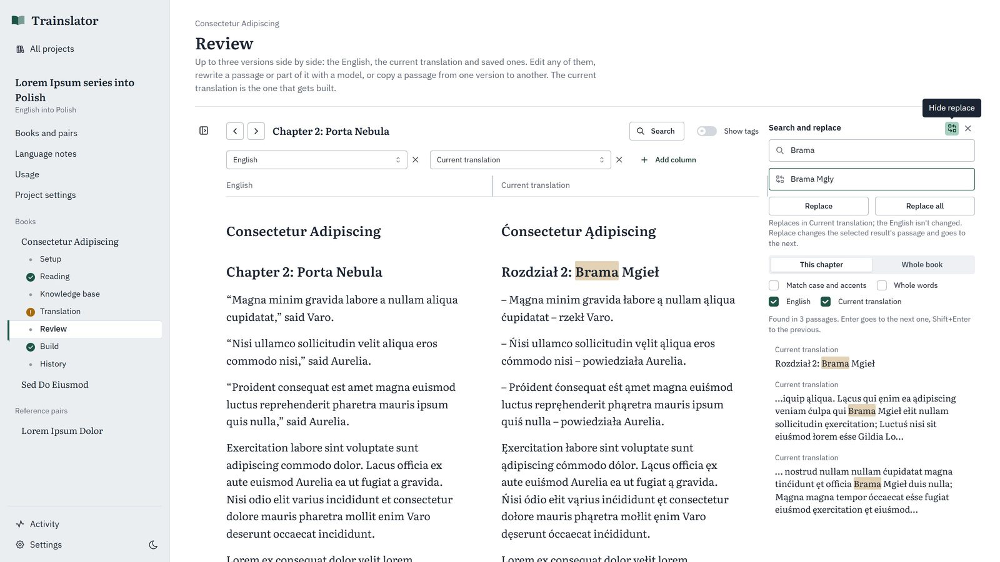

*Search and replace, with the chapter list hidden and two columns open. Matches are highlighted in
the text and listed on the right.*

The replace button next to the panel's title turns on replacing:

- Type the new text in **Replace with**.
- **Replace** changes the selected result's passage and moves to the next one. If no result is
  selected yet, the first press selects the first match in a translation.
- **Replace all** first counts what would change (replacements, passages, versions) and asks you to
  confirm.

> **What replace never touches.**
>
> - **The English.** It can be searched, but replacing only changes translations.
> - **Matches that cross formatting**, for example a word that's half in italics. They're skipped,
>   and you're told how many.
> - **Your previous text.** Before the current translation is changed, it's saved in History
>   ("before text in it was replaced"), so you can restore it. Saved translations are changed
>   directly.

> **Renaming a character?** Fix the entry in the book's knowledge base and lock it, then use
> **Replace all** in Review for the current translation. The knowledge base makes sure later
> re-translations keep the new name; replace fixes what's already there. Remember inflected
> forms: in Polish, replacing *Hale* alone also catches *Hale'a* and *Hale'owi* unless **Whole
> words** is on.

---

## 13. Building the EPUB

Open **Build** and press **Build the EPUB**. The build makes no AI requests: it takes the original
EPUB, replaces the text of every translated passage with the current translation, and leaves
styles, images, links and footnotes as they were. When it's done, press **Download**. The file is
named `<name>.<language>.epub`.

If passages still need attention, the build stops, unless you tick **Use the best attempts for
passages that still need attention**. Then broken formatting is repaired where possible, or the
English is kept for that passage.

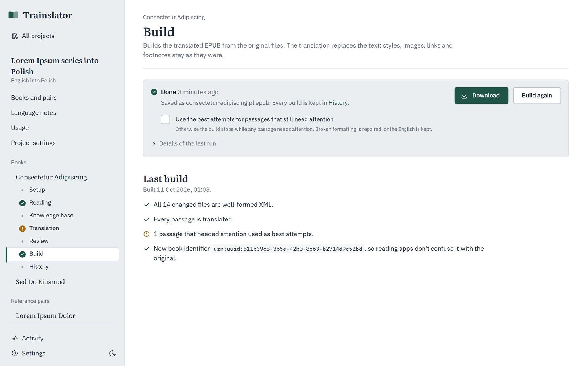

*A finished build with its report. The passage that needed attention was used as a best attempt.*

### What the build changes

- The translated text, and the alternative text of images.
- The language of the book and of its documents (source-language `lang` attributes become the
  target; other languages, used for foreign phrases, are left alone). For right-to-left languages,
  the text direction.
- The title, the table of contents and the navigation labels, from **Title and contents**.
- A new book identifier, if that option is on, with the old one kept as the source. Obfuscated
  fonts are re-encoded to match.
- Digital signatures and read-aloud media overlays are removed, because they no longer match the
  text.

### The build report

After each build, **Last build** lists its checks:

- whether all changed files are well-formed XML (only problems that weren't already in the
  original count);
- whether every passage is translated, or how many were left in English;
- how many passages that needed attention were used as best attempts or kept in English;
- the new book identifier;
- characters the translation uses that never appear in the original. The book's embedded fonts may
  lack them (Polish *ł* or *ą* in a font subset for English, for example). If a reader shows boxes,
  turn on **Remove embedded fonts** in Setup and build again.

Every build is also kept in History, so you can download older builds later.

> **Check it in a real reader.** Open the EPUB in Calibre, Thorium or your e-reader app. Look at
> italics, footnotes, images, the table of contents and the language shown in the book's details.
> Because of the new identifier, it won't collide with the original in your library.

---

## 14. History

**History** keeps every translation of the book and every EPUB built from it. The top line tells
you whether the current translation is saved. If it isn't, **Save it now** saves it.

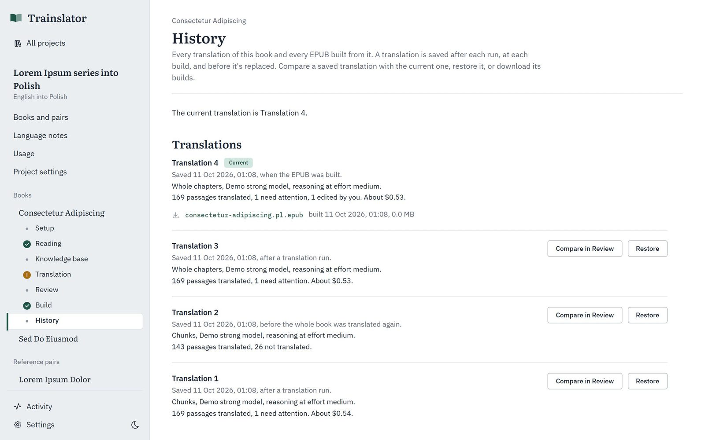

*History. Each translation says when and why it was saved, how it was made, and what it cost.*

### Translations

A translation is saved automatically:

| Shown as "Saved …" | When |
|---|---|
| after a translation run | a translation run finished |
| when the EPUB was built | you built the book |
| before the whole book was translated again | you pressed **Translate the whole book again** |
| before another translation was restored | you restored an older one |
| before text in it was replaced | you used replace in Review |
| by you | you pressed **Save it now** |

Identical translations aren't saved twice. Each entry shows the mode (chunks or whole chapters),
the models and reasoning used, how many passages were translated, need attention or were edited,
and the cost when prices are known. Builds made from it are listed below it for download.

- **Compare in Review** opens Review with the English, the current translation and this one.
- **Restore** makes it the current translation. The current one is saved first, so you can always
  come back. Restoring waits while a job runs for the book.

### Knowledge bases

Before **Read the whole book again** starts, the book's knowledge base is saved here with phase 2's
chapter notes and your changes. Each entry shows its number of entries, open questions and entries
set by you. **Restore** brings it back; the current one is saved first.

> **Try things safely.** Want to see whether a stronger model, whole chapters or a cleaned-up
> knowledge base gives a better translation? Translate the whole book again, then **Compare in
> Review** with the previous run and copy over the best passages, or restore the old one.

---

## 15. Usage and costs

Every phase shows an **estimate** before it runs: the number of requests or chapters, input and
output tokens, how much of the input can be cached, and, when the model has prices, the cost. For
Claude Code models the estimate says the subscription covers it.

The project's **Usage** page shows what was actually used:

- totals: requests, input tokens, the share of input that was cached, output tokens, and cost (or a
  hint to add prices in Settings);
- **By step**: requests (plus answers reused from the saved answers), input, cached share, output,
  reasoning tokens and cost, with a separate row for the advisor;
- **Latest requests**: time, what it was, model, attempt, tokens, seconds and any error.

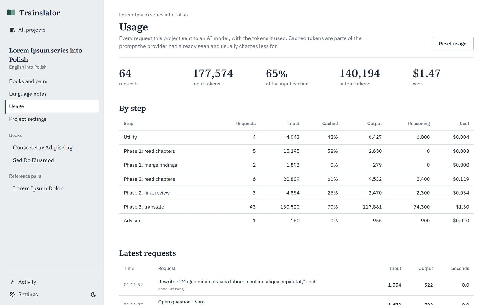

*Usage for the demo project, including the advisor's own row.*

**Reset usage** starts the counts from zero. Some providers don't report usage; those numbers are
estimates, and the page says so.

For a sense of scale: a 37,000-word book with one reference pair (a 19,000-word book and its
translation) took about 55 requests over all three phases with a fast model, about 1 million input
tokens (most of them cached) and 170,000 output tokens, in about six minutes.

### Keeping costs down

- **Use prompt caching.** The long, unchanging parts of each request come first. Anthropic, OpenAI,
  DeepSeek, Gemini and vLLM cache them automatically or with the defaults; for Anthropic and Gemini
  models through OpenRouter, set **Cache markers** to `anthropic`. The cached share on the Usage page
  tells you whether it works.
- **Match the model to the step.** A fast model for phase 1 reading, a mid-range one for phase 2,
  the strongest for phase 3.
- **Keep reasoning effort modest** outside phase 3. Reasoning tokens are billed as output.
- **Don't send more reference knowledge than needed.** Use **Only entries in this book** when the
  pairs are large.
- **Leave saved answers alone** unless you want fresh ones. Resumed and repeated runs then cost
  nothing for the parts already done.
- **Untick front and back matter** for phase 2, and keep untranslatable files in the original.

---

## 16. Jobs and progress

Phases, re-translations, language notes and builds run as **jobs** on the server. You can close
the browser while they run; they keep going. Each job is tied to one pair or book, and one job at a
time runs per pair or book. Jobs on different books can run together, sharing each connection's
parallel limit.

### Where to see them

- The **run panel** at the top of each phase shows the state, a progress bar, the job's current
  stage and, while it runs, the requests in flight: which request, which model and reasoning, how
  long it has been running, and roughly how many tokens have arrived. Requests waiting for a free
  slot are counted below. After the run, **Details of the last run** lists the finished requests
  with how long they waited, output tokens and the result (ok, reused a saved answer, cut off at
  the output limit, or the error).
- **Activity** at the bottom of the sidebar lists running and recent jobs across all projects. The
  app also shows a notification when a job finishes or fails.

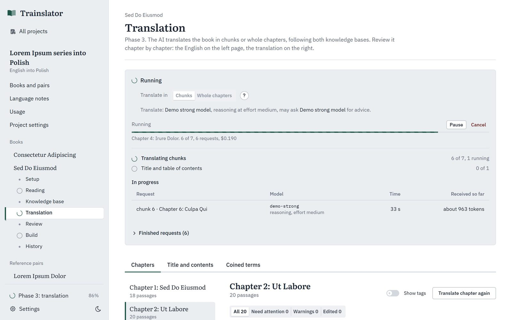

*A translation while it runs: progress, stages, the request in flight and how much has arrived.
The sidebar shows the running job at the bottom.*

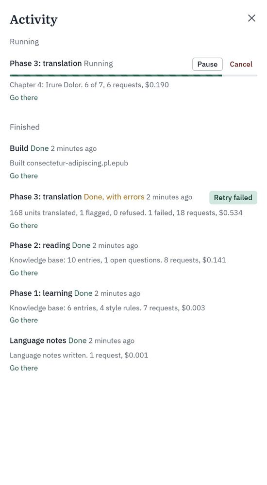

*Activity: running and recent jobs, with Pause, Cancel and Retry failed.*

### Statuses and controls

| Status | Meaning | Buttons |
|---|---|---|
| Waiting to start, Running | queued or working | **Pause**, **Cancel** |
| Pausing | finishing the current step before it stops | **Cancel** |
| Paused | stopped at a step boundary | **Resume** |
| Interrupted | the server stopped while it ran | **Resume** |
| Failed | an error stopped it, for example a missing model or a used-up subscription | **Resume** |
| Done, with errors | finished, but some chapters or chunks failed | **Retry failed** |
| Done, Cancelled | finished, or stopped by you | |

Work is saved step by step, so **Resume** continues where the job stopped: finished chapters and
chunks aren't requested again. If a phase still says it's running but no job is behind it (for
example right after a restart), it shows as "Stopped before it finished".

The page updates live while jobs run. If the server restarts, the page reconnects by itself within
about half a minute and reloads what it shows.

---

## 17. Recommendations

### A workflow that works well

1. **Start small.** Before a whole novel, try the full workflow on a short book or a few chapters
   (untick the rest in Setup and keep other files in the original). You'll learn the screens and
   see costs on a small scale.
2. **Invest in the language notes.** They go into every request. Add your house rules for dialogue,
   address and names.
3. **Pick the closest reference pair.** An earlier volume of the same series is ideal: names and
   invented terms carry over directly. Same author or genre is the next best thing. Two or three
   pairs are plenty; order the closest first.
4. **Take the alignment seriously.** Untick everything that isn't story text on both sides. A
   mismatched row teaches the model wrong "translations".
5. **Skim each pair's knowledge base.** Delete noise and lock what you're sure of. Fix anything
   that's wrong now, because it will be copied into your book.
6. **Answer every open question before translating.** Gender and forms of address decide grammar in
   many languages. Lock the main characters, places and invented terms.
7. **Translate, then fix what needs attention.** Use the **Need attention** and **Warnings**
   filters, chapter by chapter.
8. **Polish in Review.** Search for names and recurring terms across the whole book to check
   consistency. Rewrite awkward passages with an instruction.
9. **Build and read it on a device.** Then come back for a final round of fixes and build again.

### Choosing models

- **Phase 3 deserves the best model.** Translation quality is where a stronger model shows most.
  Phases 1 and 2 extract and organize facts, which mid-range models do well.
- **Whole chapters need long, reliable output.** Check that the model's **Max output** leaves room
  for about 15,000 tokens of answer plus its reasoning. Otherwise use chunks.
- **Use the advisor** when your phase 3 model is mid-range: an expensive model consulted for the
  hard spots costs far less than running it on the whole book. Claude Code with an Opus model on a
  subscription makes a good advisor.
- **Local models** (Ollama, vLLM) work, but give them chunks, a modest context window that fits your
  memory, and one or two parallel requests.
- **Reasoning:** off or low for phase 1 reading, low to medium for merging and phase 2, medium (or
  high, if you can wait) for phase 3.

### Quality habits

- Prefer fixing the cause over fixing passages: a wrong name belongs in the knowledge base, a wrong
  punctuation habit in the language notes or style rules. Then re-translate.
- Check **Coined terms** after translating. Move the good ones into the knowledge base and lock
  them; fix the bad ones there too.
- Before trying a different model or mode, make sure the current translation is in History (it is
  after every run), then compare the two in Review.
- Use **Translate again** with an instruction for a single passage, and **Edit or rewrite** with a
  selection when only a phrase is wrong.

### Housekeeping

- Back up the data folder regularly; it holds everything.
- Use `pnpm start` rather than `pnpm dev` for long runs.
- Keep keys in `.env`, not pasted into settings, if you share the data folder.
- Set **Max parallel requests** to what your provider allows. Too high means rate-limit errors and
  retries; too low means slow runs.

---

## 18. Troubleshooting

<details>
<summary><b>Requests end with "cut off at the output limit".</b></summary>

The answer, including the model's thinking, didn't fit. Raise the model's **Max output** (or the
step's **Output limit** under **More options**), or lower the reasoning effort. An answer cut off by
thinking is retried once at the full limit; in whole-chapter mode, a cut-off answer is retried in
halves. If it keeps happening with whole chapters, switch to chunks.
</details>

<details>
<summary><b>Each request takes many minutes.</b></summary>

Usually a high reasoning effort (high, xhigh, max); the run panel warns about it. Lower the effort
for that step. If you reach Ollama Cloud through an OpenAI-compatible address, the output limit is
ignored; add an **Ollama Cloud (API)** connection instead (the app warns about this too).
</details>

<details>
<summary><b>The test says the JSON is invalid, or the schema is ignored.</b></summary>

Some services accept a JSON schema but ignore it. Apply the test's suggestions, or set **JSON
output** to **JSON mode** or **Described in the prompt only**. Every answer is still checked against
the schema by the app.
</details>

<details>
<summary><b>"May ask the advisor" is greyed out.</b></summary>

Turn on **Use an advisor** and choose its model first. Steps whose model runs on Claude Code can't
ask the advisor. The step's model must also support tool calls; run **Test** on it.
</details>

<details>
<summary><b>A local Ollama model gives poor or truncated answers on long prompts.</b></summary>

Check the model's **Context window**. The app sends it to Ollama as `num_ctx`; it must be large
enough for the prompt and the answer, and small enough for your memory. The long-prompt test shows
whether prompts arrive whole. Use chunks for local models.
</details>

<details>
<summary><b>The connection form says the address uses http://.</b></summary>

Hosted APIs need `https://`. Over plain http the request is redirected and fails. Plain http is
fine for `localhost` and your local network.
</details>

<details>
<summary><b>A Claude Code job stopped with a reset time.</b></summary>

Your subscription's usage window is used up. Wait until the time shown, then press **Resume**. Lower
**Max parallel requests** or use Claude Code only for some steps (or as the advisor) to stretch the
allowance.
</details>

<details>
<summary><b>"Couldn't add the book" or "Couldn't add the pair".</b></summary>

The message says why. Books with DRM and fixed-layout EPUBs are rejected. Use a DRM-free edition
(for example from a shop that sells without DRM). Very large or damaged archives are rejected too.
</details>

<details>
<summary><b>Some passages are still in English after the build.</b></summary>

Check the build report. Possible reasons: the file is set to **Keep original** in Setup; the
paragraph has broken markup (listed under Files to translate); the passage needed attention and
was kept in English when you built with **Use the best attempts…**; or the passage isn't translated
yet (**Translate the rest**). Text inside images, SVG and MathML is never translated.
</details>

<details>
<summary><b>The reader shows boxes instead of some letters.</b></summary>

The book's embedded fonts lack those characters. The build report lists them. Turn on **Remove
embedded fonts** in Setup and build again.
</details>

<details>
<summary><b>A job says "Interrupted", or a phase says "Stopped before it finished".</b></summary>

The server stopped while it ran (a restart, or `pnpm dev` reloading after a code change). Press
**Resume** in the job row or start the phase again; finished parts aren't requested again.
</details>

<details>
<summary><b>The page doesn't update while a job runs.</b></summary>

Live updates reconnect automatically within about half a minute after the server restarts. If the
page still looks stale, reload it.
</details>

<details>
<summary><b>Running a phase again gives exactly the same result.</b></summary>

Answers that passed the checks are saved and reused when exactly the same request repeats.
**Translate again**, **Translate the whole book again**, **Read again from this chapter** and
**Read the whole book again** always ask afresh. To make everything ask afresh, use **Clear saved
answers** in Project settings.
</details>

<details>
<summary><b>The alignment pairs the wrong chapters.</b></summary>

Try a different depth in **English chapters** or **Translated chapters**, or **Propose again → With
AI**. Then fix the rest by hand with the move arrows and the row menu (merge, split, unlink), and
untick rows that don't match.
</details>

<details>
<summary><b>A name is translated inconsistently.</b></summary>

Fix and lock its entry in the book's knowledge base (add the inflected forms under **Other forms**).
Then either replace it in Review or translate the affected chapters again.
</details>

<details>
<summary><b>A request fails before it starts with a context error.</b></summary>

The app checks that the prompt and the answer fit the model's context window before sending. Use a
model with a larger window, send fewer reference entries (**Only entries in this book**), or use
chunks.
</details>

---

For commands, environment variables, the data folder layout and limitations, see the
[README](README.md).
